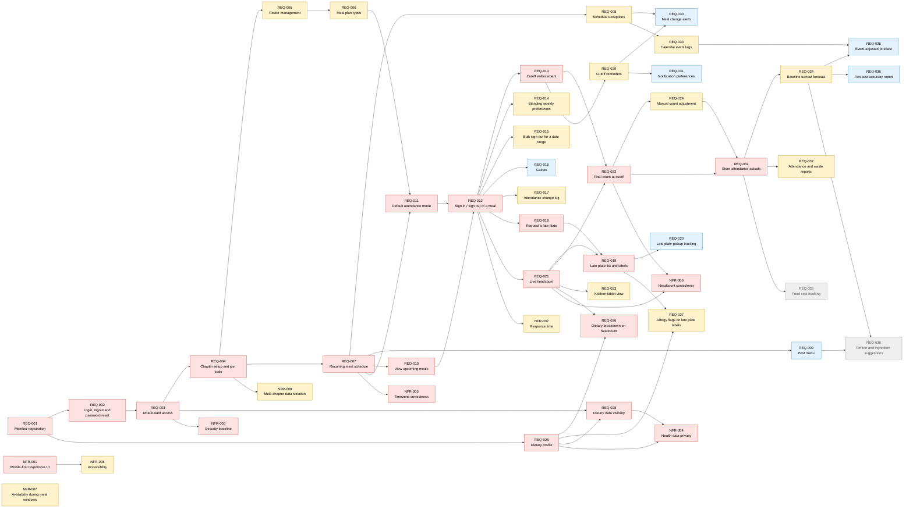

# PlateCount — Product Backlog (Elicitation Pass 1)

Initial requirements backlog for **PlateCount**, a meal headcount and planning system for Greek-life house kitchens. This is the output of a first pass of requirements elicitation: it is expected to change as stakeholders (members, kitchen staff, house directors) review it.

## Metadata key

| Field | Meaning |
|---|---|
| **ID** | `REQ-###` functional, `NFR-###` non-functional |
| **Epic** | Feature area the requirement belongs to |
| **Type** | Functional or Non-functional |
| **Stakeholder** | Primary role that benefits |
| **Priority** | MoSCoW: Must / Should / Could / Won't (this term) |
| **Points** | Relative effort estimate (Fibonacci: 1, 2, 3, 5, 8) |
| **Depends on** | Requirements that must be done first |
| **Blocks** | Requirements waiting on this one |
| **Tags** | Cross-cutting labels (e.g., `security`, `data-engineering`, `core`) |

## Summary

| Priority | Count | Story points |
|---|---|---|
| Must | 22 | 66 |
| Should | 17 | 51 |
| Could | 7 | 22 |
| Won't (this term) | 2 | 13 |
| **Total** | **48** | **152** |

**Stakeholders:** Member, Kitchen Staff, House Director, Chapter Admin, Chapter Treasurer.

## Epics

| Epic | Name | Requirements |
|---|---|---|
| E1 | Accounts, Roles & Chapter Setup | REQ-001, REQ-002, REQ-003, REQ-004, REQ-005, REQ-006 |
| E2 | Meal Schedule | REQ-007, REQ-008, REQ-009, REQ-010 |
| E3 | Meal Attendance (Sign-in / Sign-out) | REQ-011, REQ-012, REQ-013, REQ-014, REQ-015, REQ-016, REQ-017 |
| E4 | Late Plates | REQ-018, REQ-019, REQ-020 |
| E5 | Dietary Restrictions & Allergies | REQ-025, REQ-026, REQ-027, REQ-028 |
| E6 | Kitchen Headcount Dashboard | REQ-021, REQ-022, REQ-023, REQ-024 |
| E7 | Notifications | REQ-029, REQ-030, REQ-031 |
| E8 | Attendance Data & Forecasting | REQ-032, REQ-033, REQ-034, REQ-035, REQ-036, REQ-037 |
| E9 | Ordering & Cost (Future) | REQ-038, REQ-039 |
| NFR | Non-Functional Requirements | NFR-001, NFR-002, NFR-003, NFR-004, NFR-005, NFR-006, NFR-007, NFR-008, NFR-009 |

## Backlog at a glance

| ID | Title | Epic | Type | Stakeholder | Priority | Pts | Depends on |
|---|---|---|---|---|---|---|---|
| [REQ-001](#req-001) | Member registration | E1 | Functional | Member | Must | 3 | — |
| [REQ-002](#req-002) | Login, logout and password reset | E1 | Functional | All users | Must | 3 | REQ-001 |
| [REQ-003](#req-003) | Role-based access | E1 | Functional | Chapter Admin | Must | 5 | REQ-002 |
| [REQ-004](#req-004) | Chapter setup and join code | E1 | Functional | Chapter Admin | Must | 3 | REQ-003 |
| [REQ-005](#req-005) | Roster management | E1 | Functional | Chapter Admin | Should | 3 | REQ-004 |
| [REQ-006](#req-006) | Meal plan types | E1 | Functional | House Director | Should | 2 | REQ-005 |
| [REQ-007](#req-007) | Recurring meal schedule | E2 | Functional | House Director | Must | 5 | REQ-004 |
| [REQ-008](#req-008) | Schedule exceptions | E2 | Functional | House Director | Should | 3 | REQ-007 |
| [REQ-009](#req-009) | Post menu | E2 | Functional | Kitchen Staff | Could | 2 | REQ-007 |
| [REQ-010](#req-010) | View upcoming meals | E2 | Functional | Member | Must | 2 | REQ-007 |
| [REQ-011](#req-011) | Default attendance mode | E3 | Functional | House Director | Must | 3 | REQ-006, REQ-007 |
| [REQ-012](#req-012) | Sign in / sign out of a meal | E3 | Functional | Member | Must | 3 | REQ-010, REQ-011 |
| [REQ-013](#req-013) | Cutoff enforcement | E3 | Functional | Kitchen Staff | Must | 3 | REQ-012 |
| [REQ-014](#req-014) | Standing weekly preferences | E3 | Functional | Member | Should | 3 | REQ-012 |
| [REQ-015](#req-015) | Bulk sign-out for a date range | E3 | Functional | Member | Should | 2 | REQ-012 |
| [REQ-016](#req-016) | Guests | E3 | Functional | Member | Could | 2 | REQ-012 |
| [REQ-017](#req-017) | Attendance change log | E3 | Functional | House Director | Should | 3 | REQ-012 |
| [REQ-018](#req-018) | Request a late plate | E4 | Functional | Member | Must | 3 | REQ-012 |
| [REQ-019](#req-019) | Late plate list and labels | E4 | Functional | Kitchen Staff | Must | 2 | REQ-018, REQ-021 |
| [REQ-020](#req-020) | Late plate pickup tracking | E4 | Functional | Kitchen Staff | Could | 2 | REQ-019 |
| [REQ-021](#req-021) | Live headcount | E6 | Functional | Kitchen Staff | Must | 5 | REQ-012 |
| [REQ-022](#req-022) | Final count at cutoff | E6 | Functional | Kitchen Staff | Must | 2 | REQ-013, REQ-021 |
| [REQ-023](#req-023) | Kitchen tablet view | E6 | Functional | Kitchen Staff | Should | 3 | REQ-021 |
| [REQ-024](#req-024) | Manual count adjustment | E6 | Functional | Kitchen Staff | Should | 2 | REQ-022 |
| [REQ-025](#req-025) | Dietary profile | E5 | Functional | Member | Must | 3 | REQ-001 |
| [REQ-026](#req-026) | Dietary breakdown on headcount | E5 | Functional | Kitchen Staff | Must | 3 | REQ-021, REQ-025 |
| [REQ-027](#req-027) | Allergy flags on late plate labels | E5 | Functional | Kitchen Staff | Should | 2 | REQ-019, REQ-025 |
| [REQ-028](#req-028) | Dietary data visibility | E5 | Functional | Member | Must | 2 | REQ-003, REQ-025 |
| [REQ-029](#req-029) | Cutoff reminders | E7 | Functional | Member | Should | 5 | REQ-013 |
| [REQ-030](#req-030) | Meal change alerts | E7 | Functional | Member | Could | 3 | REQ-008, REQ-029 |
| [REQ-031](#req-031) | Notification preferences | E7 | Functional | Member | Could | 2 | REQ-029 |
| [REQ-032](#req-032) | Store attendance actuals | E8 | Functional | House Director | Must | 3 | REQ-022, REQ-024 |
| [REQ-033](#req-033) | Calendar event tags | E8 | Functional | House Director | Should | 3 | REQ-008 |
| [REQ-034](#req-034) | Baseline turnout forecast | E8 | Functional | Kitchen Staff | Should | 5 | REQ-032 |
| [REQ-035](#req-035) | Event-adjusted forecast | E8 | Functional | Kitchen Staff | Could | 8 | REQ-033, REQ-034 |
| [REQ-036](#req-036) | Forecast accuracy report | E8 | Functional | House Director | Could | 3 | REQ-034 |
| [REQ-037](#req-037) | Attendance and waste reports | E8 | Functional | House Director | Should | 5 | REQ-032 |
| [REQ-038](#req-038) | Portion and ingredient suggestions | E9 | Functional | Kitchen Staff | Won't (this term) | 8 | REQ-009, REQ-034 |
| [REQ-039](#req-039) | Food cost tracking | E9 | Functional | Chapter Treasurer | Won't (this term) | 5 | REQ-032 |
| [NFR-001](#nfr-001) | Mobile-first responsive UI | NFR | Non-functional | All users | Must | 3 | — |
| [NFR-002](#nfr-002) | Response time | NFR | Non-functional | Member | Should | 2 | REQ-012 |
| [NFR-003](#nfr-003) | Security baseline | NFR | Non-functional | All users | Must | 3 | REQ-003 |
| [NFR-004](#nfr-004) | Health data privacy | NFR | Non-functional | Member | Must | 2 | REQ-025, REQ-028 |
| [NFR-005](#nfr-005) | Timezone correctness | NFR | Non-functional | House Director | Must | 2 | REQ-007 |
| [NFR-006](#nfr-006) | Headcount consistency | NFR | Non-functional | Kitchen Staff | Must | 3 | REQ-021, REQ-022 |
| [NFR-007](#nfr-007) | Availability during meal windows | NFR | Non-functional | All users | Should | 2 | — |
| [NFR-008](#nfr-008) | Accessibility | NFR | Non-functional | All users | Should | 3 | NFR-001 |
| [NFR-009](#nfr-009) | Multi-chapter data isolation | NFR | Non-functional | Chapter Admin | Should | 3 | REQ-004 |

## Dependency graph

Arrows point from a prerequisite to the requirement that depends on it. Colors show priority (GitHub renders this automatically).

**Critical path for the MVP:** REQ-001 → REQ-002 → REQ-003 → REQ-004 → REQ-007 → REQ-010 / REQ-011 → REQ-012 → REQ-013 → REQ-021 → REQ-022 → REQ-032 → REQ-034. Sign-in/out (REQ-012) is the hub: 9 requirements depend on it directly.

## Requirement details

### E1 — Accounts, Roles & Chapter Setup

#### REQ-001

**Member registration**

As a member, I want to create an account with my university email so that my meal responses are tied to me.

- **Type:** Functional · **Stakeholder:** Member · **Priority:** Must · **Points:** 3
- **Depends on:** None
- **Blocks:** REQ-002, REQ-025
- **Tags:** `auth` `onboarding`
- **Acceptance criteria:**
  - Registration requires a valid email and password
  - Email must be verified before the account is active
  - Duplicate emails are rejected

#### REQ-002

**Login, logout and password reset**

As a user, I want to log in, log out and reset a forgotten password so that I can access my account securely.

- **Type:** Functional · **Stakeholder:** All users · **Priority:** Must · **Points:** 3
- **Depends on:** REQ-001
- **Blocks:** REQ-003
- **Tags:** `auth` `security`
- **Acceptance criteria:**
  - Valid credentials start a session; invalid ones show a generic error
  - Password reset link is emailed and expires after 1 hour
  - Logout ends the session on that device

#### REQ-003

**Role-based access**

As a chapter admin, I want users assigned roles (Member, Kitchen Staff, House Director, Chapter Admin) so that each person sees only what they need.

- **Type:** Functional · **Stakeholder:** Chapter Admin · **Priority:** Must · **Points:** 5
- **Depends on:** REQ-002
- **Blocks:** REQ-004, REQ-028, NFR-003
- **Tags:** `auth` `security` `permissions`
- **Acceptance criteria:**
  - Each user has exactly one role per chapter
  - Permissions are enforced on the server, not only hidden in the UI
  - Only Chapter Admins can change roles

#### REQ-004

**Chapter setup and join code**

As a chapter admin, I want to create my house and invite members with a join code so that onboarding a whole chapter is fast.

- **Type:** Functional · **Stakeholder:** Chapter Admin · **Priority:** Must · **Points:** 3
- **Depends on:** REQ-003
- **Blocks:** REQ-005, REQ-007, NFR-009
- **Tags:** `onboarding` `multi-tenant`
- **Acceptance criteria:**
  - Admin can create a chapter with name, address and timezone
  - A join code is generated and can be regenerated
  - Members who join with the code are pending until approved

#### REQ-005

**Roster management**

As a chapter admin, I want to approve, remove and label members as live-in or live-out so that the roster matches who actually eats at the house.

- **Type:** Functional · **Stakeholder:** Chapter Admin · **Priority:** Should · **Points:** 3
- **Depends on:** REQ-004
- **Blocks:** REQ-006
- **Tags:** `admin` `roster`
- **Acceptance criteria:**
  - Admin can approve or reject pending members
  - Admin can deactivate a member without deleting history
  - Each member is labeled live-in or live-out

#### REQ-006

**Meal plan types**

As a house director, I want to assign each member a meal plan (e.g., full, lunch-only, none) so that only eligible members appear in each meal's count.

- **Type:** Functional · **Stakeholder:** House Director · **Priority:** Should · **Points:** 2
- **Depends on:** REQ-005
- **Blocks:** REQ-011
- **Tags:** `roster` `configuration`
- **Acceptance criteria:**
  - Plans define which meals a member is eligible for
  - Ineligible members cannot sign in to those meals
  - Changing a plan affects future meals only

### E2 — Meal Schedule

#### REQ-007

**Recurring meal schedule**

As a house director, I want to define the weekly meal schedule with serve times and a sign-out cutoff for each meal so that members know the deadlines.

- **Type:** Functional · **Stakeholder:** House Director · **Priority:** Must · **Points:** 5
- **Depends on:** REQ-004
- **Blocks:** REQ-008, REQ-009, REQ-010, REQ-011, NFR-005
- **Tags:** `scheduling` `configuration`
- **Acceptance criteria:**
  - Each meal has a name, days of week, serve time and cutoff
  - Meals are generated for the semester from the template
  - Cutoff is stored in the chapter's timezone

#### REQ-008

**Schedule exceptions**

As a house director, I want to cancel or add individual meals for holidays, breaks and chapter events so that the schedule reflects reality.

- **Type:** Functional · **Stakeholder:** House Director · **Priority:** Should · **Points:** 3
- **Depends on:** REQ-007
- **Blocks:** REQ-030, REQ-033
- **Tags:** `scheduling`
- **Acceptance criteria:**
  - A single meal or a date range can be cancelled
  - One-off meals can be added
  - Cancelled meals are hidden from members and excluded from reports

#### REQ-009

**Post menu**

As kitchen staff, I want to post the menu for each meal so that members can decide whether to eat.

- **Type:** Functional · **Stakeholder:** Kitchen Staff · **Priority:** Could · **Points:** 2
- **Depends on:** REQ-007
- **Blocks:** REQ-038
- **Tags:** `menu`
- **Acceptance criteria:**
  - Staff can add or edit menu text per meal
  - Menu changes after posting are timestamped

#### REQ-010

**View upcoming meals**

As a member, I want to see the upcoming meals, their cutoffs and my current status so that I don't miss a deadline.

- **Type:** Functional · **Stakeholder:** Member · **Priority:** Must · **Points:** 2
- **Depends on:** REQ-007
- **Blocks:** REQ-012
- **Tags:** `member-ui`
- **Acceptance criteria:**
  - Shows at least the next 7 days of meals
  - Each meal shows serve time, cutoff, my status and menu if posted

### E3 — Meal Attendance (Sign-in / Sign-out)

#### REQ-011

**Default attendance mode**

As a house director, I want to choose whether members are counted in or out by default so that the system matches how my house already works.

- **Type:** Functional · **Stakeholder:** House Director · **Priority:** Must · **Points:** 3
- **Depends on:** REQ-006, REQ-007
- **Blocks:** REQ-012
- **Tags:** `attendance` `configuration`
- **Acceptance criteria:**
  - Chapter setting: default-in (sign out to skip) or default-out (sign in to eat)
  - Default applies to every eligible member for every generated meal
  - Changing the mode affects future meals only

#### REQ-012

**Sign in / sign out of a meal**

As a member, I want to change my status for a meal in two taps or fewer so that responding is effortless.

- **Type:** Functional · **Stakeholder:** Member · **Priority:** Must · **Points:** 3
- **Depends on:** REQ-010, REQ-011
- **Blocks:** REQ-013, REQ-014, REQ-015, REQ-016, REQ-017, REQ-018, REQ-021, NFR-002
- **Tags:** `attendance` `member-ui` `core`
- **Acceptance criteria:**
  - Status toggles from the meal list without opening another page
  - Change is reflected in the live headcount within 5 seconds
  - Confirmation is shown to the member

#### REQ-013

**Cutoff enforcement**

As kitchen staff, I want changes locked after the cutoff so that the count I cook for doesn't move.

- **Type:** Functional · **Stakeholder:** Kitchen Staff · **Priority:** Must · **Points:** 3
- **Depends on:** REQ-012
- **Blocks:** REQ-022, REQ-029
- **Tags:** `attendance` `business-rule`
- **Acceptance criteria:**
  - Members cannot change status after cutoff
  - Staff and House Director can still override with a note
  - UI shows a countdown to cutoff

#### REQ-014

**Standing weekly preferences**

As a member, I want to set recurring preferences (e.g., always out for Friday dinner) so that I don't have to respond every week.

- **Type:** Functional · **Stakeholder:** Member · **Priority:** Should · **Points:** 3
- **Depends on:** REQ-012
- **Blocks:** None
- **Tags:** `attendance` `automation`
- **Acceptance criteria:**
  - Member can set a preference per meal slot
  - Preferences apply to newly generated meals
  - One-off changes override the standing preference

#### REQ-015

**Bulk sign-out for a date range**

As a member, I want to sign out of every meal between two dates so that I can handle trips and breaks at once.

- **Type:** Functional · **Stakeholder:** Member · **Priority:** Should · **Points:** 2
- **Depends on:** REQ-012
- **Blocks:** None
- **Tags:** `attendance`
- **Acceptance criteria:**
  - Member picks a start and end date
  - All eligible meals in range are set to out
  - Meals past cutoff are not changed

#### REQ-016

**Guests**

As a member, I want to add guests to a meal so that the kitchen accounts for visitors.

- **Type:** Functional · **Stakeholder:** Member · **Priority:** Could · **Points:** 2
- **Depends on:** REQ-012
- **Blocks:** None
- **Tags:** `attendance`
- **Acceptance criteria:**
  - Member can add 1-3 guests per meal before cutoff
  - Guests are shown separately in the headcount
  - House Director can disable guests

#### REQ-017

**Attendance change log**

As a house director, I want a log of who changed what and when so that disputes can be resolved.

- **Type:** Functional · **Stakeholder:** House Director · **Priority:** Should · **Points:** 3
- **Depends on:** REQ-012
- **Blocks:** None
- **Tags:** `audit` `data`
- **Acceptance criteria:**
  - Every status change records user, old value, new value and timestamp
  - Log is read-only and filterable by member and meal

### E4 — Late Plates

#### REQ-018

**Request a late plate**

As a member, I want to request a late plate before the cutoff with a pickup note so that I can eat when class runs late.

- **Type:** Functional · **Stakeholder:** Member · **Priority:** Must · **Points:** 3
- **Depends on:** REQ-012
- **Blocks:** REQ-019
- **Tags:** `late-plate` `core`
- **Acceptance criteria:**
  - Request available only before cutoff
  - Optional note (e.g., pickup time, no onions)
  - Requesting a late plate counts the member as eating

#### REQ-019

**Late plate list and labels**

As kitchen staff, I want a list of late plates with printable name labels so that I can package them without texts.

- **Type:** Functional · **Stakeholder:** Kitchen Staff · **Priority:** Must · **Points:** 2
- **Depends on:** REQ-018, REQ-021
- **Blocks:** REQ-020, REQ-027
- **Tags:** `late-plate` `kitchen-ui`
- **Acceptance criteria:**
  - List shows name, note and dietary flags
  - Labels print on a standard sheet

#### REQ-020

**Late plate pickup tracking**

As kitchen staff, I want to mark late plates picked up or not so that we can track waste from uncollected plates.

- **Type:** Functional · **Stakeholder:** Kitchen Staff · **Priority:** Could · **Points:** 2
- **Depends on:** REQ-019
- **Blocks:** None
- **Tags:** `late-plate` `data`
- **Acceptance criteria:**
  - Each late plate can be marked picked up / not picked up
  - Uncollected late plates feed waste reports

### E5 — Dietary Restrictions & Allergies

#### REQ-025

**Dietary profile**

As a member, I want to record my dietary restrictions and allergies once so that the kitchen always knows.

- **Type:** Functional · **Stakeholder:** Member · **Priority:** Must · **Points:** 3
- **Depends on:** REQ-001
- **Blocks:** REQ-026, REQ-027, REQ-028, NFR-004
- **Tags:** `dietary` `privacy` `health-data`
- **Acceptance criteria:**
  - Choose from a standard list (vegetarian, vegan, gluten-free, nut allergy, etc.) plus free text
  - Member can edit or clear the profile at any time

#### REQ-026

**Dietary breakdown on headcount**

As kitchen staff, I want each meal's count broken down by restriction so that I prepare the right number of alternate plates.

- **Type:** Functional · **Stakeholder:** Kitchen Staff · **Priority:** Must · **Points:** 3
- **Depends on:** REQ-021, REQ-025
- **Blocks:** None
- **Tags:** `dietary` `dashboard`
- **Acceptance criteria:**
  - Shows counts per restriction for members marked in
  - Severe allergies are visually highlighted

#### REQ-027

**Allergy flags on late plate labels**

As kitchen staff, I want allergy flags printed on late plate labels so that a plate never goes to the wrong person.

- **Type:** Functional · **Stakeholder:** Kitchen Staff · **Priority:** Should · **Points:** 2
- **Depends on:** REQ-019, REQ-025
- **Blocks:** None
- **Tags:** `dietary` `late-plate` `safety`
- **Acceptance criteria:**
  - Labels include allergy icons/text for that member

#### REQ-028

**Dietary data visibility**

As a member, I want my dietary and allergy information visible only to kitchen staff and the house director so that my health information stays private.

- **Type:** Functional · **Stakeholder:** Member · **Priority:** Must · **Points:** 2
- **Depends on:** REQ-003, REQ-025
- **Blocks:** NFR-004
- **Tags:** `privacy` `security` `health-data`
- **Acceptance criteria:**
  - Other members cannot see dietary data
  - Access is enforced server-side by role

### E6 — Kitchen Headcount Dashboard

#### REQ-021

**Live headcount**

As kitchen staff, I want a live count of who is eating each meal so that I know how much to prepare.

- **Type:** Functional · **Stakeholder:** Kitchen Staff · **Priority:** Must · **Points:** 5
- **Depends on:** REQ-012
- **Blocks:** REQ-019, REQ-022, REQ-023, REQ-026, NFR-006
- **Tags:** `dashboard` `real-time` `core`
- **Acceptance criteria:**
  - Shows total in, total out, guests and late plates
  - Updates without a page refresh
  - Shows today's meals first

#### REQ-022

**Final count at cutoff**

As kitchen staff, I want the count frozen at cutoff with a timestamp so that I have a reliable number to cook to.

- **Type:** Functional · **Stakeholder:** Kitchen Staff · **Priority:** Must · **Points:** 2
- **Depends on:** REQ-013, REQ-021
- **Blocks:** REQ-024, REQ-032, NFR-006
- **Tags:** `dashboard` `business-rule`
- **Acceptance criteria:**
  - Final count is saved when cutoff passes
  - Later overrides are shown as adjustments, not silent changes

#### REQ-023

**Kitchen tablet view**

As kitchen staff, I want a large, glanceable view for a kitchen tablet so that I can check the count while cooking.

- **Type:** Functional · **Stakeholder:** Kitchen Staff · **Priority:** Should · **Points:** 3
- **Depends on:** REQ-021
- **Blocks:** None
- **Tags:** `kitchen-ui` `ux`
- **Acceptance criteria:**
  - Large-type layout readable from about 2 meters
  - Stays awake / auto-refreshes during meal windows

#### REQ-024

**Manual count adjustment**

As kitchen staff, I want to record walk-ins and the number actually served so that the data reflects reality.

- **Type:** Functional · **Stakeholder:** Kitchen Staff · **Priority:** Should · **Points:** 2
- **Depends on:** REQ-022
- **Blocks:** REQ-032
- **Tags:** `dashboard` `data`
- **Acceptance criteria:**
  - Staff enter actual served count after the meal
  - Adjustments require a short reason

### E7 — Notifications

#### REQ-029

**Cutoff reminders**

As a member, I want a reminder before cutoff so that I remember to update my status.

- **Type:** Functional · **Stakeholder:** Member · **Priority:** Should · **Points:** 5
- **Depends on:** REQ-013
- **Blocks:** REQ-030, REQ-031
- **Tags:** `notifications`
- **Acceptance criteria:**
  - Reminder sent a configurable time before cutoff (default 2 hours)
  - Delivered by push or email

#### REQ-030

**Meal change alerts**

As a member, I want to be notified when a meal is cancelled or the menu changes so that I can adjust my plans.

- **Type:** Functional · **Stakeholder:** Member · **Priority:** Could · **Points:** 3
- **Depends on:** REQ-008, REQ-029
- **Blocks:** None
- **Tags:** `notifications`
- **Acceptance criteria:**
  - Cancellation alerts go to everyone signed in to that meal
  - Menu change alerts are opt-in

#### REQ-031

**Notification preferences**

As a member, I want to control which notifications I get and how so that the app isn't annoying.

- **Type:** Functional · **Stakeholder:** Member · **Priority:** Could · **Points:** 2
- **Depends on:** REQ-029
- **Blocks:** None
- **Tags:** `notifications` `settings`
- **Acceptance criteria:**
  - Per-type on/off toggles
  - Choose push, email or both

### E8 — Attendance Data & Forecasting

#### REQ-032

**Store attendance actuals**

As a house director, I want every meal's final count, adjustments and actual served stored so that we can analyze attendance over time.

- **Type:** Functional · **Stakeholder:** House Director · **Priority:** Must · **Points:** 3
- **Depends on:** REQ-022, REQ-024
- **Blocks:** REQ-034, REQ-037, REQ-039
- **Tags:** `data` `data-engineering` `analytics`
- **Acceptance criteria:**
  - One record per meal with final count, adjustments, served count and late plates
  - Data retained for at least 2 academic years

#### REQ-033

**Calendar event tags**

As a house director, I want to tag dates (exam week, home game, break, chapter event) so that forecasts account for unusual days.

- **Type:** Functional · **Stakeholder:** House Director · **Priority:** Should · **Points:** 3
- **Depends on:** REQ-008
- **Blocks:** REQ-035
- **Tags:** `data` `forecasting`
- **Acceptance criteria:**
  - Tags apply to a date or date range
  - Tags are visible on the meal schedule

#### REQ-034

**Baseline turnout forecast**

As kitchen staff, I want a predicted turnout for upcoming meals based on history so that I can plan before members respond.

- **Type:** Functional · **Stakeholder:** Kitchen Staff · **Priority:** Should · **Points:** 5
- **Depends on:** REQ-032
- **Blocks:** REQ-035, REQ-036, REQ-038
- **Tags:** `forecasting` `data-engineering` `analytics`
- **Acceptance criteria:**
  - Forecast uses a moving average by meal and day of week
  - Shown beside the live count for meals in the next 7 days
  - Hidden until at least 3 weeks of data exist

#### REQ-035

**Event-adjusted forecast**

As kitchen staff, I want forecasts adjusted for exam weeks, game days and breaks so that predictions stay accurate on unusual days.

- **Type:** Functional · **Stakeholder:** Kitchen Staff · **Priority:** Could · **Points:** 8
- **Depends on:** REQ-033, REQ-034
- **Blocks:** None
- **Tags:** `forecasting` `data-engineering`
- **Acceptance criteria:**
  - Forecast applies a learned adjustment factor per tag
  - Shows which tags influenced the prediction

#### REQ-036

**Forecast accuracy report**

As a house director, I want to compare forecast vs. actual so that I know whether to trust the predictions.

- **Type:** Functional · **Stakeholder:** House Director · **Priority:** Could · **Points:** 3
- **Depends on:** REQ-034
- **Blocks:** None
- **Tags:** `analytics` `reporting`
- **Acceptance criteria:**
  - Shows forecast, actual and error for each past meal
  - Reports mean absolute error per meal type

#### REQ-037

**Attendance and waste reports**

As a house director, I want reports on no-show rates, late plate pickup and attendance trends, exportable to CSV, so that I can reduce waste and justify budget decisions.

- **Type:** Functional · **Stakeholder:** House Director · **Priority:** Should · **Points:** 5
- **Depends on:** REQ-032
- **Blocks:** None
- **Tags:** `analytics` `reporting` `data`
- **Acceptance criteria:**
  - Filter by date range and meal
  - Includes no-show rate (counted in but not served)
  - Export to CSV

### E9 — Ordering & Cost (Future)

#### REQ-038

**Portion and ingredient suggestions**

As kitchen staff, I want ingredient quantities suggested from the forecast and recipe yields so that ordering is less guesswork.

- **Type:** Functional · **Stakeholder:** Kitchen Staff · **Priority:** Won't (this term) · **Points:** 8
- **Depends on:** REQ-009, REQ-034
- **Blocks:** None
- **Tags:** `ordering` `future`
- **Acceptance criteria:**
  - Recipes store yield per serving
  - Suggested quantities scale with the forecast

#### REQ-039

**Food cost tracking**

As a chapter treasurer, I want cost per meal and per member tracked so that the chapter can see the money saved by reducing waste.

- **Type:** Functional · **Stakeholder:** Chapter Treasurer · **Priority:** Won't (this term) · **Points:** 5
- **Depends on:** REQ-032
- **Blocks:** None
- **Tags:** `finance` `future`
- **Acceptance criteria:**
  - Staff enter grocery spend per week
  - Reports cost per meal served

### NFR — Non-Functional Requirements

#### NFR-001

**Mobile-first responsive UI**

The member interface shall be fully usable on phone screens 360px wide and up.

- **Type:** Non-functional · **Stakeholder:** All users · **Priority:** Must · **Points:** 3
- **Depends on:** None
- **Blocks:** NFR-008
- **Tags:** `usability` `mobile`
- **Acceptance criteria:**
  - All member flows work at 360px width without horizontal scrolling

#### NFR-002

**Response time**

Sign-in/out actions shall complete in under 1 second at the 95th percentile for a chapter of 150 members.

- **Type:** Non-functional · **Stakeholder:** Member · **Priority:** Should · **Points:** 2
- **Depends on:** REQ-012
- **Blocks:** None
- **Tags:** `performance`
- **Acceptance criteria:**
  - Load test with 150 concurrent users meets the target

#### NFR-003

**Security baseline**

The system shall hash passwords, use HTTPS everywhere and enforce role permissions server-side.

- **Type:** Non-functional · **Stakeholder:** All users · **Priority:** Must · **Points:** 3
- **Depends on:** REQ-003
- **Blocks:** None
- **Tags:** `security`
- **Acceptance criteria:**
  - Passwords hashed with a modern algorithm (bcrypt/argon2)
  - No endpoint returns data outside the user's role

#### NFR-004

**Health data privacy**

Dietary and allergy data shall be collected minimally, visible only to authorized roles and deletable by the member.

- **Type:** Non-functional · **Stakeholder:** Member · **Priority:** Must · **Points:** 2
- **Depends on:** REQ-025, REQ-028
- **Blocks:** None
- **Tags:** `privacy` `health-data`
- **Acceptance criteria:**
  - Member can delete their dietary profile
  - Access to dietary data is logged

#### NFR-005

**Timezone correctness**

All schedules and cutoffs shall be evaluated in the chapter's local timezone, including daylight saving changes.

- **Type:** Non-functional · **Stakeholder:** House Director · **Priority:** Must · **Points:** 2
- **Depends on:** REQ-007
- **Blocks:** None
- **Tags:** `reliability` `scheduling`
- **Acceptance criteria:**
  - Cutoffs fire correctly across a DST transition in tests

#### NFR-006

**Headcount consistency**

Concurrent status changes near the cutoff shall never produce an incorrect final count.

- **Type:** Non-functional · **Stakeholder:** Kitchen Staff · **Priority:** Must · **Points:** 3
- **Depends on:** REQ-021, REQ-022
- **Blocks:** None
- **Tags:** `reliability` `concurrency`
- **Acceptance criteria:**
  - Simultaneous updates are serialized or transactional
  - Final count equals the sum of stored statuses

#### NFR-007

**Availability during meal windows**

The system shall be available 99% of the time during meal windows.

- **Type:** Non-functional · **Stakeholder:** All users · **Priority:** Should · **Points:** 2
- **Depends on:** None
- **Blocks:** None
- **Tags:** `reliability` `ops`
- **Acceptance criteria:**
  - Uptime monitoring and alerting in place

#### NFR-008

**Accessibility**

The UI shall meet WCAG 2.1 AA.

- **Type:** Non-functional · **Stakeholder:** All users · **Priority:** Should · **Points:** 3
- **Depends on:** NFR-001
- **Blocks:** None
- **Tags:** `accessibility`
- **Acceptance criteria:**
  - Passes automated accessibility checks
  - Fully usable with keyboard and screen reader

#### NFR-009

**Multi-chapter data isolation**

Data for each chapter shall be isolated so that houses never see each other's data.

- **Type:** Non-functional · **Stakeholder:** Chapter Admin · **Priority:** Should · **Points:** 3
- **Depends on:** REQ-004
- **Blocks:** None
- **Tags:** `security` `multi-tenant` `scalability`
- **Acceptance criteria:**
  - Every query is scoped by chapter
  - Automated tests verify cross-chapter access is denied

## Open questions from elicitation

- Should the default be "counted in" or "counted out"? (Varies by house — REQ-011 makes it configurable, but each chapter needs to decide.)
- Do live-out members eat at the house, and do they pay per meal or per semester?
- Does the chapter already use a Greek-life management platform that this should integrate with instead of duplicating rosters?
- How early do kitchen staff actually need a final count to change how much they cook? This determines default cutoff times.
- Who owns dietary data, and what consent is needed before staff can see allergy information?
- Is a native mobile app expected, or is a mobile-friendly web app with push notifications enough for the first release?
